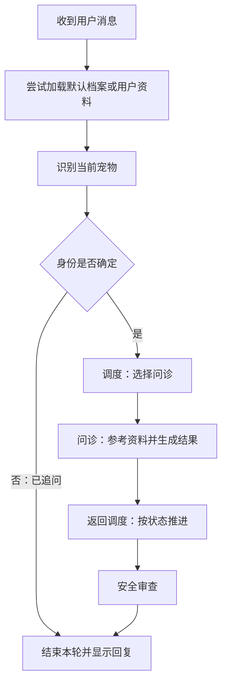

# 1.2 一条消息的旅程

讲解日期：2026-11-07。状态：已讲解／答疑中，未确认理解。

## 核心结论

- 一次 `app.invoke()` 执行一轮工作流，内部可经过多个节点和模型调用。
- 节点读取共享状态并返回更新，流程根据边与条件选择下一步；并非每个节点都会调用模型。
- 问诊与推荐返回 Supervisor；安全与病历节点结束本轮。并非所有请求都走完整问诊路径。
- 未识别宠物时可能追问后结束；结束本轮后，命令行仍可接收下一条输入。
- 入口只显示最后一条非空文本 AI 消息，不自动合并所有节点答复。

## 术语

| 术语 | 含义 |
|---|---|
| 工作流 | 一组处理步骤及其执行关系 |
| 节点 | 工作流中的处理步骤，通常对应函数 |
| 路由 | 根据条件选择下一步 |
| State（状态） | 流程共享的数据，如消息、档案和处理结果 |
| RAG（Retrieval-Augmented Generation） | 检索增强生成：检索资料后供模型参考 |
| MCP（Model Context Protocol） | 模型上下文协议：本项目借此接入病历工具 |

## 示例路径及前提

教学输入：“旺财是一只犬，最近一直挠，想了解可能的原因。”不是实际运行记录。

以下选取新会话的一条成功问诊路径：身份抽取成功，路由选择问诊，问诊抽取产出非空诊断字典，状态没有既有 `safety_flag`。省略摘要、内部工具循环、错误回退及其他专家分支。两次“调度”是同一个 Supervisor 节点。



## 实现要点与关键代码

1. [main.py](../../main.py)：`main()` 在输入循环前调用 `build_graph()`；每次输入包装为 `HumanMessage` 后调用 `app.invoke()`。
2. [graph.py](../../petdoctor/graph.py)：`load_memory_node()` 尝试读取默认宠物档案或用户资料；不是已经完成本轮目标宠物识别。
3. [identity.py](../../petdoctor/identity.py)：`identify_pet_node()` 匹配/建档，设置 `active_pet_id`，加载或刷新当前宠物档案与历史；不足则保留草稿并追问。
4. [graph.py](../../petdoctor/graph.py)：`route_after_identify()` 依据 `active_pet_id` 决定是否进入 Supervisor。

```python
return "supervisor" if state.get("active_pet_id") else END
```

5. [supervisor.py](../../petdoctor/agents/supervisor.py)：`supervisor_node()` 在新用户回合调用模型路由；Worker 返回后按状态分支推进。
6. [ask_symptom.py](../../petdoctor/agents/ask_symptom.py)：`ask_symptom_node()` 预检索知识、组装输入、调用 Agent、抽取症状/诊断并返回消息和状态更新。
7. [safe_check.py](../../petdoctor/agents/safe_check.py)：`safe_check_node()` 做关键词/模型审查，safe/warning 时尝试写历史，追加自己的 AI 消息，随后图结束。
8. [main.py](../../main.py)：`_print_answer()` 倒序选择最后一条非空文本 AI 消息。

部分真实连线：

```python
workflow.add_edge("ask_symptom_agent", "supervisor")
workflow.add_edge("recommend_product_agent", "supervisor")
workflow.add_edge("safe_check_agent", END)
workflow.add_edge("record_agent", END)
```

## 模块协作与边界

| 信息/能力 | 进入路径的位置 |
|---|---|
| 当前宠物档案与历史 | 识别节点加载；问诊节点组装成模型输入 |
| 知识资料 | 问诊预检索及 Agent 内部可调用的检索工具 |
| 外部病历 | MCP 工具可用时供问诊 Agent 调用；病历节点也可直接调用 |
| 问诊结果 | 通过共享状态供后续调度及安全审查使用 |
| 历史保存 | 安全分级为 safe/warning 时尝试写入 |

## 易混淆点

- 并非问诊后自动推荐产品；问诊和推荐是独立路由选择。
- 工具已挂载不代表每次都会调用；问诊预检索是明确代码执行，内部病历工具调用则不能保证发生。
- Worker 返回 Supervisor 不意味着再次用模型决定同一任务。
- 上述图不是所有回合的保证：已有安全标记或抽取失败等会改变后续分支。
- 安全节点追加的消息可能成为入口最终显示内容；不能把问诊节点内部答案当成必然展示的答案。
- `END` 是结束这轮图执行，不是退出主程序。

## 验证范围与答疑

本次仅静态核对源码，未运行应用、调用模型或修改业务代码。分支风险留待状态及安全章节展开。

重要答疑：暂无。
