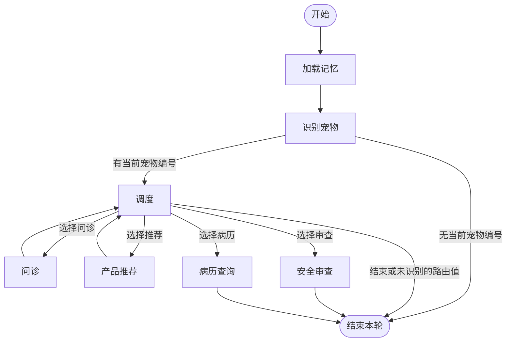

# 3.1 节点和边怎样组成工作流

讲解日期：2026-11-07。状态：已讲解／答疑中，未确认理解。

用户明确要求直接开始第三章。未讲的 1.3 和第二章仍为未开始；本节仅补充理解本节必要的基础。

## 核心结论

- 通用原理：图用节点表达工作，用有方向的边表达执行关系；工作流也可以用普通函数与条件语句实现。
- 本项目使用 LangGraph `StateGraph(PetClinicState)` 描述外层工作流，核心组装位置是 `_assemble()`。
- 节点是注册到图中的处理函数，不等于一次模型调用；节点注册顺序不决定执行顺序。
- 普通边规定固定后继；条件边执行路由函数，再按返回值选择目的地。
- Supervisor 写入 `next_agent`；`route_from_supervisor()` 读取该字段并返回路由。后者自身不调用模型。
- `compile()` 生成可执行图；`invoke()` 提交输入执行。编译不等于模型训练或业务正确性验证。
- 问诊/推荐回调度，安全/病历到 END；本项目不是每个专家都会执行的流水线。

## 术语简释

| 术语 | 含义 |
|---|---|
| Graph（图） | 节点及其连接关系，不是必须显示出来的图片 |
| Node（节点） | 一个处理步骤；本项目主要注册 Python 函数 |
| Edge（边） | 执行步骤之间的有向连接 |
| Conditional edge（条件边） | 通过路由函数返回值选择后续步骤 |
| State（状态） | 节点可读取并更新的共享数据；详细合并规则留到 3.2 |
| START / END | 图的入口和结束标记，不是业务 Agent |
| compile / invoke | 生成可执行图 / 用具体输入执行图 |

## 实际外层图

保留 `_assemble()` 的外层节点与连接；省略节点内部模型/工具调用、状态字段、摘要、存储和异常处理。多条分支表示本项目路由择一，并不表示并行调用所有 Worker。功能下线拦截在节点内部，不单独画成图节点。



## 关键文件与实现

- [graph.py](../../petdoctor/graph.py)：`_assemble()`、`route_after_identify()`、`route_from_supervisor()`、`build_graph()`。
- [state.py](../../petdoctor/state.py)：`PetClinicState`，声明共享状态结构。
- [supervisor.py](../../petdoctor/agents/supervisor.py)：`supervisor_node()`，产出 `next_agent`。
- [main.py](../../main.py)：`main()`，构建应用并逐轮调用 `invoke()`。

注册示例（源码节选，非独立可执行脚本）：

```python
workflow = StateGraph(PetClinicState)
workflow.add_node("identify_pet", identify_pet_node)
workflow.add_node("supervisor", supervisor_node)
```

字符串是节点名，后面的函数对象是实际工作实现；注册不会立即调用该节点函数。

条件边（源码）：

```python
workflow.add_conditional_edges(
    "identify_pet",
    route_after_identify,
    {"supervisor": "supervisor", END: END},
)
```

三个参数依次是出发节点、路由函数、返回值到目标节点的映射。

```python
def route_after_identify(state: PetClinicState) -> str:
    return "supervisor" if state.get("active_pet_id") else END
```

身份节点执行并更新状态后，路由函数读取 `active_pet_id` 选择下一步。函数没有调用模型。

`route_from_supervisor()` 则读取 `next_agent`；其值属于 `WORKER_NODES` 时返回对应节点名，否则返回 END（包括 FINISH 或缺失字段）。

构建阶段在 `_assemble()` 最后执行：

```python
return workflow.compile(checkpointer=checkpointer, store=store)
```

`checkpointer` 接入会话检查点，`store` 接入长期数据存储；详细机制留到记忆章节。`build_graph()` 还负责准备记忆、加载/分配 MCP 工具并按配置附加日志，构图启动阶段并非毫无外部动作；编译这一行本身不等于执行一轮问诊。

## 与其他模块协作

| 本项目中的层次 | 主要职责 |
|---|---|
| LangGraph 外层图 | 共享状态上的节点连接、分支与执行 |
| 节点内部的 LangChain 组件 | 消息、模型/工具调用以及部分 Agent 构建 |
| 普通业务代码 | 查档案、规则判断、格式化病历等 |
| 命令行入口 | 提交用户消息并显示结果 |

这是当前项目的分工，不是两个框架互斥的通用定义；LangChain 的 Agent 可以建立在 LangGraph 之上。

## 易混淆点

- 节点名称、函数名、模型名称是不同概念。
- 添加节点不代表该节点一定会运行；实际执行看连线、路由与当前状态。
- 图中存在安全节点不代表所有请求都经过它；无宠物编号的分支可以结束。
- 问诊回到调度后，调度根据状态决定后续；不是无条件再次问诊，也不是无条件转安全。
- END 结束本轮图执行，命令行主循环仍可继续。
- 可以返回旧节点的图不必然死循环，终止取决于状态和路由；终止细节留到 3.3。

## 验证范围与答疑

本节依据当前源码静态阅读，未运行图或调用模型，不宣称完成运行验证。只更新教学文件。

重要答疑：暂无。
