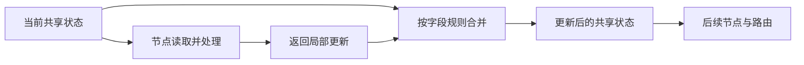

# 3.2 State：节点之间传什么

讲解日期：2026-11-08。状态：已讲解／答疑中，未确认理解。

## 核心结论

- State 是图共享的工作数据；节点读取状态并返回局部更新，由图按字段规则合并，再供后续节点和路由使用。
- 本项目 `PetClinicState` 使用 TypedDict 描述字典结构，`NotRequired` 表示键允许缺失，不会自动创建默认值；类型声明本身不是运行时数据校验。
- 顺序执行下，普通字段收到新值就替换整个字段；未返回的字段保留原值。嵌套字典不自动逐键合并，普通列表不自动追加。
- `messages` 通过 `Annotated[..., add_messages]` 指定合并函数：新消息标识追加，同标识更新，支持专门删除消息。
- 外层 State 不等于子 Agent 的消息轨迹，也不等于模型本次收到的上下文。进入模型的信息需要通过输入组装、提示词等实际传入。
- 状态保留也会保留旧业务字段；不能把“未更新”理解为“已清空”或“仍是本轮结论”。

## 术语简释

| 术语 | 含义 |
|---|---|
| State | 共享工作数据，例如消息、档案、症状与路由结果 |
| TypedDict | 声明字典的预期字段与类型，运行时数据仍是普通字典 |
| NotRequired | 该键可以不存在，不代表自动赋空值 |
| Annotated | 为类型附加元信息；此处指定字段的合并函数 |
| Reducer | 合并函数，定义旧字段值怎样与更新值组合 |
| 上下文 | 本次实际提供给模型的信息，包含指令、消息及选取的数据等 |

## 字段与作用

| 字段 | 作用与更新特点 |
|---|---|
| messages | 对话消息，使用 add_messages 合并 |
| active_pet_id / pet_profile / pet_history | 当前宠物编号、档案、历史；普通字段替换 |
| symptoms / diagnosis / product_recommendations | 症状、诊断、推荐工作结果；列表或字典均整体替换 |
| next_agent / safety_flag | 路由与安全标记；保留旧值可能影响分支 |
| rag_context / session_summary | 检索内容和会话摘要 |
| pet_draft | 身份信息暂存草稿；identity 中由业务函数手动合并草稿，图不会自动深层合并 |

## 关键文件与函数

- [state.py](../../petdoctor/state.py)：`PetClinicState`。
- [ask_symptom.py](../../petdoctor/agents/ask_symptom.py)：`ask_symptom_node()` 返回更新；`_build_agent_input()` 选择并组织模型输入。
- [identity.py](../../petdoctor/identity.py)：`identify_pet_node()` 返回档案/草稿更新；`_merge_draft()` 手动合并草稿。
- [supervisor.py](../../petdoctor/agents/supervisor.py)：`supervisor_node()` 读结果并写路由；`summarize_if_needed()` 使用删除消息指令替换历史。
- [graph.py](../../petdoctor/graph.py)：路由函数读取合并后的状态。

源码节选：

```python
class PetClinicState(TypedDict):
    messages: Annotated[list[AnyMessage], add_messages]
    pet_profile: NotRequired[dict]
    symptoms: NotRequired[list[str]]
    diagnosis: NotRequired[dict]
```

问诊节点成功分支的真实返回：

```python
return {
    "symptoms": assessment.symptoms,
    "diagnosis": diagnosis,
    "rag_context": rag_context,
    "messages": [AIMessage(content=reply)],
}
```

未返回 `pet_profile` 不会删除已有档案。新 AI 消息通常获得新标识，追加到消息列表；问诊子 Agent 的所有内部消息不会因此自动复制到外层状态。

## 合并示例

下表是教学推演，非实测输出。假设节点更新提供新症状列表、新 AI 消息，未更新档案和安全标记：

| 字段 | 更新前 | 节点返回 | 合并后 |
|---|---|---|---|
| symptoms | `["抓挠"]` | `["抓挠", "掉毛"]` | `["抓挠", "掉毛"]`，整体替换 |
| pet_profile | 旺财档案 | 未提供 | 原档案保留 |
| safety_flag | `"safe"` | 未提供 | 旧 `"safe"` 保留，不代表本轮已审查 |
| messages | 已有对话 | 一条新标识消息 | 已有对话加新消息 |

`symptoms: []` 会清空普通症状列表；`messages: []` 不会通过 add_messages 清空历史。删除消息需要专门删除指令，摘要节点已有相应使用。

## 状态与上下文



图仅表现一次顺序节点执行的数据交接，省略存储、子 Agent 内部循环及异常。

问诊 `_build_agent_input()` 把档案、历史和检索内容转为文字，形成 `SystemMessage` 并放在消息前面，然后返回子 Agent 输入。此处构造的是本次调用输入，不会仅因构造了列表就自动把系统消息写入外层状态。模型也不会因为某个字段存在于外层状态就自动知道其内容。

## 易混淆点

- 合并规则不是按“字典/列表”简单决定，而是按具体字段声明决定；本项目只有 messages 声明了 add_messages。
- 对话内容未重复但消息标识不同，仍可能作为不同消息追加；add_messages 不是按文本去重。
- 外层节点状态、子 Agent 内部轨迹、模型输入和长期数据库记录不是同一份东西。
- State 类型声明不等于 Pydantic 输出校验，后者留待结构化输出章节。
- Supervisor 会读取 safety_flag 等旧值；当前没有统一每轮清空全部业务字段的入口逻辑。这是静态观察，不在本任务中修复，后续回顾/安全章节讨论影响。

## 验证范围与答疑

本次只静态阅读项目及本地已安装依赖源码，未运行应用、测试或模型调用。

合并语义核对来源（本地环境文件，不属于项目业务代码）：

- [LangGraph 消息合并](../../.venv/Lib/site-packages/langgraph/graph/message.py)：`add_messages()`。
- [状态通道选择](../../.venv/Lib/site-packages/langgraph/graph/state.py)：`_get_channel()`。
- [默认字段存储](../../.venv/Lib/site-packages/langgraph/channels/last_value.py)：`LastValue.update()`。

重要答疑：暂无。
