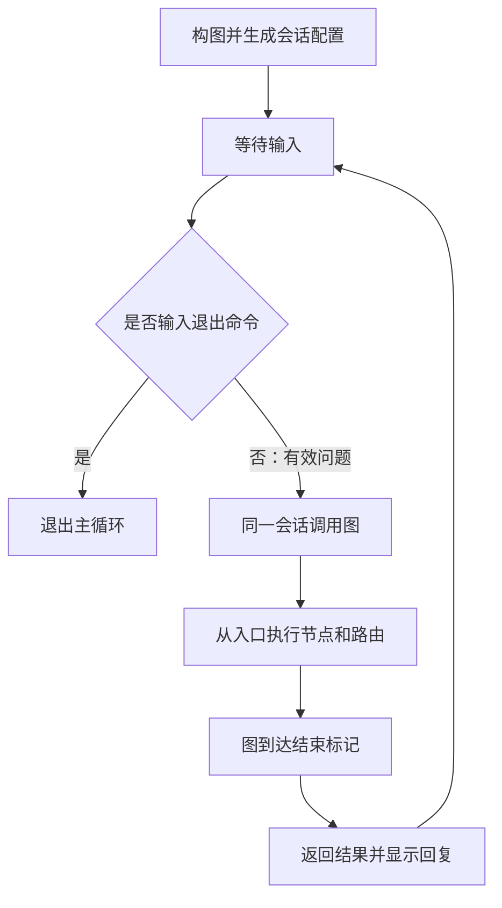

# 3.3 回顾：一轮结束为什么不等于会话结束

讲解日期：2026-11-08。状态：已讲解／答疑中，未确认理解。

## 核心结论

- 节点执行、单轮图调用、跨轮会话和 Python 进程是不同层次。
- 本项目存在命令行输入循环和图内节点回路。图到达 END 不会触发主程序的 break。
- 同一终端会话复用图对象与 config。每条有效输入触发一次 invoke；检查点通过 thread_id 关联已有状态。
- 正常完成上一轮后提交下一条新输入，会重新从图入口执行，不是停在最后一个 Worker 等待用户输入。
- Worker 返回 Supervisor 后，调度按当前状态选择 FINISH 或安全审查，不会因回到同一节点就必然重复执行同一 Worker。
- END 不清空状态。旧业务字段可影响下一轮路径，需区分“延续会话的信息”和“本轮是否已完成处理”的标记。
- recursion_limit 是执行步数上限，超限会报错；不是会话轮数、模型调用次数，也不是正常业务结束条件。

## 层次与术语

| 层次 | 本项目中的例子 |
|---|---|
| 节点执行 | 调用一次 ask_symptom_node |
| 一轮图执行 | main 中对一条有效用户消息调用一次 app.invoke |
| 会话 | 多次 invoke 通过相同 thread_id 关联状态 |
| 进程 | 一次 Python 程序运行；可包含输入循环并承载内存存储 |
| Checkpointer（检查点保存器） | 保存/恢复会话状态的组件；此节仅解释作用 |
| recursion_limit | 图执行步数上限；框架步数也称 superstep，不等同于用户轮次或模型调用数 |

## 主程序与图的关系



图省略空输入、异常、节点内部回路和存储细节，只画正常调用的控制关系。

## 关键文件与实现

- [main.py](../../main.py)：`main()` 在 while 之前创建 app/config，退出命令触发 break；循环内 invoke 后打印结果。
- [memory.py](../../petdoctor/memory.py)：`make_config()` 将 session_id 放入 configurable.thread_id；`get_checkpointer()` 选择 PostgreSQL 或内存检查点实现。
- [graph.py](../../petdoctor/graph.py)：`_assemble()` 连接 START、Worker 回边以及 END，compile 时传入 checkpointer。
- [supervisor.py](../../petdoctor/agents/supervisor.py)：`supervisor_node()` 区分用户新消息与 Worker 返回。
- [safe_check.py](../../petdoctor/agents/safe_check.py)：返回 safety_flag；safe/warning 时尝试写入长期历史。

入口教学节选（省略空输入过滤、退出别名和打印细节）：

```python
while True:
    query = input("\n请输入你的问题：").strip()
    if query.lower() == "q":
        break
    result = app.invoke({"messages": [HumanMessage(content=query)]}, config=config)
    _print_answer(result)
```

图内回路的关键源码：

```python
if not is_new_turn:
    updates = dict(summary_updates)
    if state.get("safety_flag"):
        updates["next_agent"] = "FINISH"
    elif state.get("diagnosis") or state.get("product_recommendations"):
        updates["next_agent"] = "safe_check_agent"
    else:
        updates["next_agent"] = "FINISH"
    return updates
```

此分支不再调用意图路由 Agent，但此前的摘要步骤仍可能调用模型。FINISH 经 route_from_supervisor 转为 END。安全节点自身直接连 END，不需要先回 Supervisor 才结束。

## 两轮状态推演与风险

下面是源码静态推演，不是实际模型运行。前提：第一轮产生问诊结果并完成 safe 审查；第二轮继续相同 thread_id 且再次被路由到问诊，问诊结束后回 Supervisor。

| 时刻 | safety_flag | 相关行为 |
|---|---|---|
| 第一轮问诊返回 | 尚无值 | 有 diagnosis，转安全审查 |
| 第一轮安全返回 | safe | 图结束，检查点保留状态 |
| 第二轮新消息进入 | 仍为 safe | 新用户消息可触发新的意图路由，旧标记不会在此直接阻止该路由 |
| 第二轮问诊返回 | 仍为 safe | 命中 not is_new_turn 内的首个条件，设置 FINISH，可能跳过本轮再次审查 |

当前入口、识别及问诊路径没有统一每轮清空 safety_flag 的逻辑。上述具体条件成立时可静态推导此分支；不能泛化为所有第二轮都会跳过安全，模型直接路由安全等路径不同。只记录，未修复业务代码。

## 结束与限制

- END 结束本轮图执行，不删除会话检查点或长期记录。
- q/quit/exit 退出主循环；使用内存存储时进程结束后不能靠同一会话编号恢复旧内存。
- 跨重启恢复需检查点被持久保存且可访问；会话编号本身不包含历史。
- `config["recursion_limit"] = 25` 在入口配置图执行上限。框架超限抛 GraphRecursionError，主入口未捕获该异常，不是自动生成友好结束回复。
- 限制只防止执行无止境推进，不能证明分支逻辑、最终回答或多轮安全正确。

## 易混淆点

- 新一次 invoke 不必然是新会话；相同 thread_id 与可用检查点能够延续状态。
- 复用会话不表示下一轮跳过图入口。
- FINISH 是调度字段值，END 是图结束标记，break 是退出 Python 输入循环。
- 回边是否继续取决于状态与路由，不取决于“是否已经执行过这个函数”。
- 第三章已讲完不等于用户已确认理解；各节状态仍为已讲解／答疑中。

## 验证范围与答疑

本次静态核对当前业务代码与 [本地 LangGraph 执行器](../../.venv/Lib/site-packages/langgraph/pregel/main.py) 的超限异常分支，未运行应用、测试或调用模型。

重要答疑：暂无。
