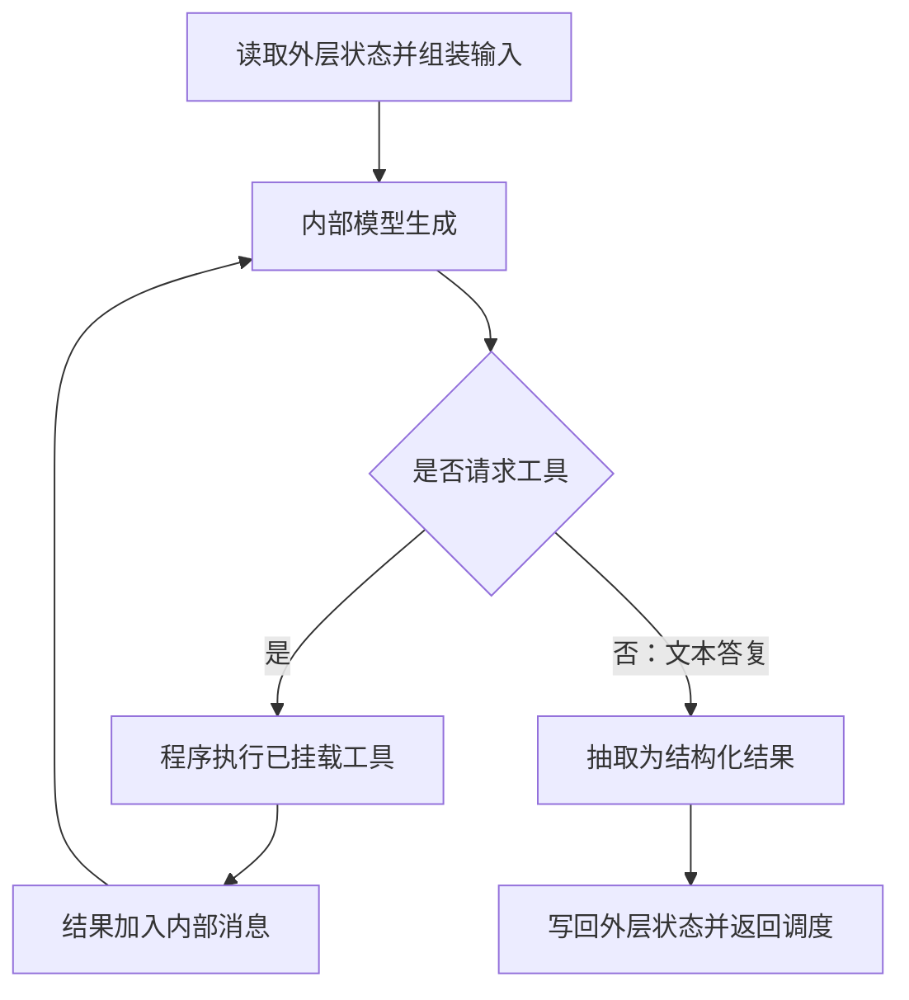

# 4.2 问诊与推荐为什么分开

日期：2026-11-08。状态：已讲解／答疑中，未确认理解。本次与 4.1、4.3 连续讲解。

## 核心结论

- 分工由职责提示、输入选择、工具集合、输出结构与图路由共同形成，不是改名字就产生专业能力。
- 两个 Worker 共用 get_llm 配置入口，没有各自训练独立模型的实现。
- 问诊节点执行预检索，随后 Agent 仍可自行使用工具；推荐节点没有同样的预检索调用，其提示词要求先检索。提示词要求不能等同于代码强制执行。
- 两者都是先执行可调用工具的 Agent，再将文本抽取成结构化结果，最后写回外层 State。
- 问诊与推荐不直接互相调用。推荐可读取已有 diagnosis，但外层图并不要求必须先问诊才能推荐。

## 术语

- RAG（Retrieval-Augmented Generation）：检索增强生成。
- MCP（Model Context Protocol）：模型上下文协议，本项目用于病历工具接入。
- 工具调用循环：模型请求工具 → 程序执行 → 工具结果返回模型 → 模型继续生成或请求工具。
- 输入组装：选取状态信息并转成具体模型消息。

## 对照

| 方面 | 问诊 | 产品推荐 |
|---|---|---|
| 指令职责 | 症状收集、追问、初步判断；禁止具体产品/药品/剂量推荐 | 产品知识建议；禁止疾病诊断 |
| 额外上下文 | 档案、历史、检索内容 | 档案、历史、诊断、检索内容 |
| 默认工具 | pet_knowledge_search | pet_knowledge_search |
| 实际构图时追加工具 | 可用的 get_pet_medical_record | 未追加病历或库存工具 |
| 预检索 | 代码尝试 top_k=3 | 无对应预检索，依赖内部 Agent 调用 |
| 输出结果 | symptoms、diagnosis、rag_context、messages | product_recommendations、rag_context、messages |
| 外层下一跳 | Supervisor | Supervisor |

## 关键文件与函数

- [ask_symptom.py](../../petdoctor/agents/ask_symptom.py)：_build_agent、configure_agent、inject_rag_context、_build_agent_input、_extract_assessment、ask_symptom_node。
- [recommend_product.py](../../petdoctor/agents/recommend_product.py)：_build_agent_input、_extract_products、recommend_product_node。
- [graph.py](../../petdoctor/graph.py)：_configure_agents，实际追加病历工具给问诊及病历节点。
- [state.py](../../petdoctor/state.py)：SymptomAssessment、ProductList。
- [config.py](../../petdoctor/config.py)：get_llm。

问诊构建源码：

```python
return create_agent(
    get_llm(),
    tools=[pet_knowledge_search, *(extra_tools or [])],
    system_prompt=ASK_SYMPTOM_PROMPT,
    name="ask_symptom_agent",
)
```

推荐输入中额外读取诊断：

```python
if state.get("diagnosis"):
    context.append(f"问诊诊断结果：{state['diagnosis']}")
```

此处只是使用已有字段，不会自动触发问诊或检查它是否属于本轮。

## 内层执行示意



图概括两个 Worker 的主要逻辑，省略问诊预检索、异常、框架中间件和可能的一次多个工具调用。是否以及如何循环取决于实际输出，不能承诺调用次数。

## 失败分支与实现边界

- 抽取异常返回 None；问诊回写空 symptoms/diagnosis，推荐回写空 product_recommendations，但会保留文本回答或回退回复。文本可用不代表状态完整。
- SymptomAssessment 定义 needs_more_info，但问诊节点没有将它写入外层 State，Supervisor 也未以该字段决定等待用户；追问通过消息表达。
- Top-3 仅约束问诊预检索，不限制内部 Agent 后续所有检索。
- _collect_rag_context 收集 ToolMessage 时没有按工具名过滤；问诊的回退上下文可能混入病历工具结果，不能把字段名当作内容来源保证。
- 推荐提示词示例仍含“并确认库存”，与已下线能力及同提示词规则冲突。已记录，未修改；当前无库存工具。
- 职责提示是模型约束的一部分，不是可证明不会越界的权限隔离。

## 验证与答疑

仅静态阅读业务代码及 [本地 create_agent 实现说明](../../.venv/Lib/site-packages/langchain/agents/factory.py)，未运行模型。重要答疑：暂无。
