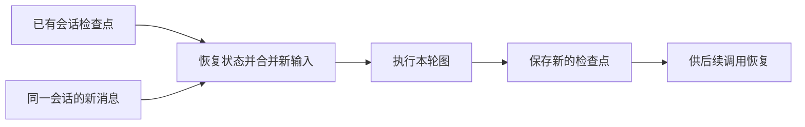

# 6.1 短期记忆：怎样接着上一轮聊

日期：2026-11-08。状态：已讲解／答疑中，未确认理解。用户要求连续讲完第六章，章末统一答疑。

## 核心结论

- 本项目短期记忆由 Checkpointer（检查点保存器）保存会话图状态，按 thread_id 关联；不等于模型参数发生学习。
- main 每轮只提交新 HumanMessage；已有状态由可用检查点恢复，消息通过 add_messages 合并，其余字段沿用各自更新规则。
- 保存范围包含会话状态与执行所需信息，不只聊天文字，也不能理解成一定包含全部子 Agent 内部轨迹。
- 短期/长期表示用途和数据组织方式，不由是否使用数据库区分，也没有代码规定短期记忆自动按时间过期。
- PostgresSaver 支持持久保存；InMemorySaver 仅在当前进程及实例生命周期有效。恢复依赖同一可访问存储，编号本身不携带历史。

## 关键文件与函数

- [main.py](../../main.py)：main 创建会话配置后，在输入循环中复用 config 调用图。
- [memory.py](../../petdoctor/memory.py)：new_session_id、make_config、get_checkpointer、set_checkpointer。
- [graph.py](../../petdoctor/graph.py)：_resolve_memory、_assemble、build_graph。
- [state.py](../../petdoctor/state.py)：PetClinicState，messages 的 add_messages 合并声明。

配置与挂接关键代码：

```python
return {"configurable": {"thread_id": thread_id, "user_id": user_id}}
```

```python
return workflow.compile(checkpointer=checkpointer, store=store)
```

get_checkpointer 初始化时读取 DATABASE_URL：配置存在则尝试创建 PostgresSaver 并 setup；初始化失败或未配置则创建 InMemorySaver。模块变量缓存已创建实例，不是每轮创建空保存器。代码不保证失败立即返回，也不是数据库运行中断后自动无损迁移的机制。

## 两轮数据关系



图为概念简化，未展开执行过程中各步的检查点、内部存储记录和错误处理；不是只在最终回复时保存一次。

## 情境速查

| 情境 | 可期待的行为及条件 |
|---|---|
| 同进程、同一图/保存器、同 thread_id | 可延续已有会话状态 |
| 更换 thread_id | 不自动继承原线程消息；仍可从 Store 加载同一用户宠物资料 |
| 重启后复用 thread_id | 需要旧检查点已持久保存且当前连接可访问 |
| 重启前使用 InMemorySaver | 旧内存不会靠重复编号恢复 |

## 易混淆点

- END 不清空检查点；新会话不是给旧会话做语义遗忘。
- Checkpointer 恢复的是状态；模型输入仍由节点构造，不保证所有状态字段都进入模型。
- user_id 在 configurable 中不意味着检查点自动按 user_id 再做一层隔离；本项目没有会话所有者校验。
- 旧 safety_flag 等工作标记也可能随状态保留，影响后续路由，见 3.3。

## 验证与答疑

静态阅读项目及 [本地 InMemorySaver](../../.venv/Lib/site-packages/langgraph/checkpoint/memory/__init__.py) 的 thread_id/检查点命名空间索引。未运行数据库、模型或恢复实验。重要答疑：暂无。
