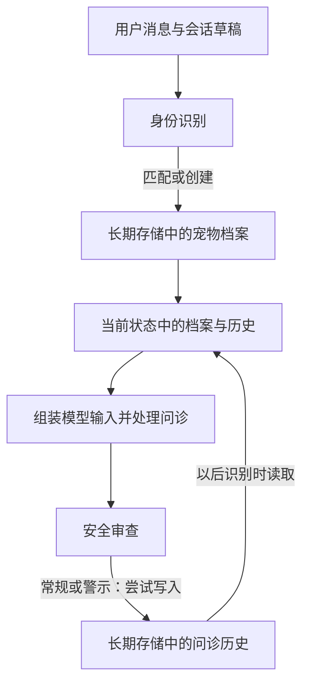

# 6.3 身份识别串起记忆的读写

日期：2026-11-08。状态：已讲解／答疑中，未确认理解。本章结束后统一答疑。

## 核心结论

- 身份识别将自然语言中的宠物信息连接到 Store 的业务键，再把读出的资料放入会话 State。
- 未识别时，模型提取最新消息的字段，代码与 pet_draft 手动合并；草稿依靠会话检查点延续。
- 已有 active_pet_id 且成功读到档案时，节点直接刷新档案/历史并返回，不重新提取该条消息。
- 当前宠物确定后，问诊/推荐主动组装档案与历史成模型输入；存储本身不让模型自动知道信息。
- safe/warning 审查路径尝试将选定的问诊字段写入长期历史；emergency 不走这次 Store 写入，但会话检查点仍可保存当轮状态。

## 关键文件与函数

- [identity.py](../../petdoctor/identity.py)：PetInfo、extract_pet_info、_merge_draft、identify_pet_node。
- [memory.py](../../petdoctor/memory.py)：create_pet、get_pet、find_pet_by_name、load_pet_history、save_diagnosis_summary。
- [ask_symptom.py](../../petdoctor/agents/ask_symptom.py)：_build_agent_input。
- [recommend_product.py](../../petdoctor/agents/recommend_product.py)：_build_agent_input。
- [safe_check.py](../../petdoctor/agents/safe_check.py)：safe_check_node。
- [graph.py](../../petdoctor/graph.py)：load_memory_node、route_after_identify。

## 身份节点顺序

1. 下线功能先固定回复。
2. active_pet_id 已存在且本用户 Store 能查到档案：刷新档案与历史，直接返回。
3. 否则提取最新消息，合并已有草稿。
4. 优先按编号、其次按名字匹配；匹配成功加载资料并清空草稿。
5. 未匹配且名字、物种齐全：自动建档，设置 active_pet_id、pet_profile，历史为空，清空草稿。
6. 尚未建档但明确给出编号：接受该编号供外部查询，即便本地无档案；不是身份所有权验证。
7. 信息不足：保存草稿并追问，由图条件边结束本轮。

两轮示例（假设提取成功，用户下无同名档案，非实际运行）：

```text
第一轮：“它叫旺财。” → pet_draft={name: 旺财} → 追问物种
第二轮：“是犬，三岁。” → 合并 name/species/age → 创建档案 → 设置当前宠物编号
```

_merge_draft 只把非空提取值覆盖到草稿，不是重新从每轮全部对话提取；空列表等不会用于清除草稿旧值。

## 记忆读写链路



图展示选定问诊成功路径的数据流，省略身份不足结束、其他专家、旧安全标记导致的分支变化、错误回退以及检查点保存。

## 写入条件与内容

```python
if flag in {"safe", "warning"}:
    memory.save_diagnosis_summary(state, config, safety_flag=flag)
```

实际保存字段：date、pet_id、symptoms、diagnosis、safety_flag、session_summary。该函数直接组装字段，不再调用模型生成一份新摘要；session_summary 可能为空。

- 有 active_pet_id 时写宠物历史，否则写用户级历史回退空间。
- key 为新生成的唯一标识，写入失败记录日志并返回 None；不能把触发调用等同于落库成功。
- 未保存全部原始消息、完整工具轨迹或专门的 product_recommendations 字段。
- 不经过 safe_check 或被旧状态提前结束的回合不保证发生这次写入；病历查询结束也不自动新增问诊历史。

## 实现边界

- graph.load_memory_node 先尝试默认宠物档案/用户资料；当前目标宠物的档案主要由 identity 加载，不能把第一个节点描述为已经知道用户本次指哪只宠物。
- 已识别且档案存在的快速返回分支会跳过新身份字段抽取，因此后续“换一只宠物”或“体重改了”等表达不构成可靠的自动切换/档案更新流程。
- 聊天记录中出现新事实、当前上下文使用了它、长期档案被更新，是三个不同事件。
- 首句身份不足结束可能阻断安全审查，历史报告已有相关问题；本次仅记录，不修复。
- 已有档案匹配也不自动把本次提取出的额外字段合并保存回旧档案。

## 验证与答疑

本次全部为当前源码静态推演，没有模型调用、数据库写入或运行验证。重要答疑：暂无。
