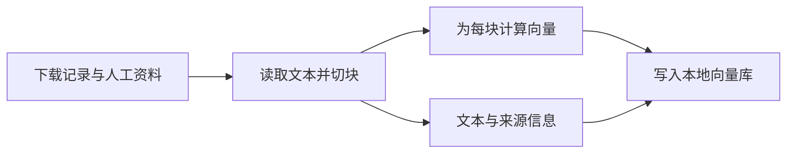

# 7.1 知识库怎样建起来

日期：2026-11-08。状态：已讲解／答疑中，未确认理解。按用户要求连续讲完第七章，章末统一答疑。

## 核心结论

- RAG（Retrieval-Augmented Generation，检索增强生成）通过检索外部资料补充模型输入；本项目建库不修改对话模型权重，也不训练 embedding 模型。
- 建库与问答检索是两个阶段。离线建库表示从日常问答流程分离，不代表整个准备过程完全不联网。
- 下载脚本将数据记录写成文本；建库脚本读取原始/人工目录、切块、向量化、存入 RAGMill SQLiteVectorStore。
- Embedding 是文本的数值表示；语义相似性用于候选检索，不代表内容事实正确。
- 本地已安装切块器按字符计数，默认 chunk_size=500、overlap=50；优先段落/句子边界，超长块再窗口切分，不是模型判定每个语义边界。

## 关键文件与函数

- [download_data.py](../../scripts/download_data.py)：SOURCES、download、_format_record、_record_condition。
- [build_rag.py](../../scripts/build_rag.py)：_collect_payloads、build。
- [config.py](../../petdoctor/config.py)：目录、RAG_DB_PATH、RAG_EMBEDDING_MODEL、RAG_CHUNK_SIZE、RAG_OVERLAP。
- [人工资料说明](../../data/manual/README.md)：资料准备建议，不等于资料已经存在或已入库。

## 建库流程



省略文件跳过、错误处理及重建分支。

项目构建节选：

```python
engine = RAGEngine(chunk_size=RAG_CHUNK_SIZE, overlap=RAG_OVERLAP)
payloads = _collect_payloads(engine)
model = EmbeddingModel(model_name=RAG_EMBEDDING_MODEL)
embeddings = model.embed([payload["content"] for payload in payloads])
with store.batch():
    store.add(payloads, embeddings)
```

chunk 为内容片段；metadata 包括来源路径、文件名、块序号等。保存内容和向量，是为了先用向量找到候选，再把文本提供给模型。

## 数据与实际技术栈

- SOURCES 声明下载 karenwky/pet-health-symptoms-dataset、SparkleDark/Everything_about_dogs 的 train split；描述的是脚本配置，本次未访问数据服务或检查完整语料质量。
- download 跳过空 text，保存来源及各非空字段，并处理文件名。分类文件名不是医学审核或按物种硬过滤。
- 配置默认 embedding 模型为 Xenova/paraphrase-multilingual-MiniLM-L12-v2，通过本地推理计算向量；模型资源首次使用可能下载。
- 当前默认库为 data/rag/pet_knowledge.db，使用 RAGMill SQLite；依赖中 Chroma 不等于实际建库路径使用 Chroma。

## 实现边界

- build 要求 raw 目录已有 txt；人工目录也只有发现 txt 才调用引擎处理该目录。只有 md 的人工目录可能被跳过，即使依赖引擎支持 Markdown。
- 库已有内容且未传 rebuild 时跳过构建；不是监控目录后自动增量更新。
- rebuild 会删除旧数据库再建，本次未执行。更换 embedding 模型需要保持建库与查询表示空间一致，不能只换查询配置沿用旧向量。
- 文档短于切块上限时不一定切成多个块；重叠减少边界损失，但增加重复和存储。
- 语料被成功写入数据库不代表质量、时效和适用物种经过验证。

## 验证与答疑

仅静态阅读项目与 [本地切块器](../../.venv/Lib/site-packages/ragmill/engine.py)、[本地向量存储](../../.venv/Lib/site-packages/ragmill/vector_store.py)。未下载数据、运行建库、加载模型或引用历史数量为当前实测。重要答疑：暂无。
