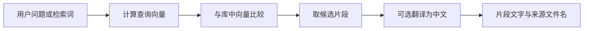

# 7.2 一个问题怎样找到资料

日期：2026-11-08。状态：已讲解／答疑中，未确认理解。

## 核心结论

- pet_knowledge_search 是 LangChain 工具；参数 query 与 top_k（默认 5）决定本次查询文本和候选数量。
- 当前顺序：初始化 → 查询向量 → 向量检索 → 可选中文翻译 → 带文件名的文本返回。
- 使用与建库一致的 embedding 配置表示查询；多语言模型用于中英跨语言匹配。当前没有先把中文问题翻译为英文的步骤。
- 相关程度是候选选择依据，不等于正确性或证据充分性。当前工具未设最低相似度阈值、物种过滤或第二阶段重排。
- 本地向量计算不等于整条工具离线：查询后的翻译默认调用 get_llm。

## 关键文件与函数

- [rag.py](../../petdoctor/tools/rag.py)：pet_knowledge_search、_ensure_ready、_translate、_get_translator、_translation_enabled。
- [config.py](../../petdoctor/config.py)：RAG_DB_PATH、RAG_EMBEDDING_MODEL、get_llm。
- [本地 EmbeddingModel](../../.venv/Lib/site-packages/ragmill/embeddings.py)：embed 返回归一化向量。
- [本地 SQLiteVectorStore](../../.venv/Lib/site-packages/ragmill/vector_store.py)：search 用点积计算分数并选择 top-k。

核心源码：

```python
query_vector = model.embed([query])[0]
results = store.search(query_vector, top_k=top_k)
```

## 查询图



省略初始化、无结果和失败分支。

## 实现细节

- _ensure_ready 惰性加载并缓存模型与存储对象，缺库时抛错；工具捕获初始化异常并返回可读字符串。
- 目前 SQLite 实现读出候选向量，在 Python 中计算点积；归一化向量的点积对应余弦相似度。不能据“向量库”推断一定使用近似最近邻索引。
- search 在候选数量大于 top_k 时使用 argpartition，选出候选集合后没有再按分数排序。因此工具 [1] 等编号是返回顺序，不应承诺严格相似度名次。
- 工具输出包含文本与 filename，未输出 score、chunk_index、完整 source_file。不是每条最终回答结论都已绑定引用。
- 翻译一次批量处理本次片段，要求 translations 与输入一一对应；异常或数量不一致时回退原文，单条空翻译也用该条原文。
- PET_RAG_TRANSLATE 默认启用，设为 0 可关闭；数量一致不是语义翻译正确的证明。
- 模型和库对象缓存不等于查询结果或翻译结果缓存，重复调用仍可能重复计算/翻译。

## 失败情况

| 情况 | 当前处理 |
|---|---|
| 初始化失败/库不存在 | 返回知识库暂不可用字符串 |
| 空库 | 返回知识库为空字符串 |
| 无检索结果 | 返回未检索到相关知识字符串 |
| 翻译失败 | 返回原文 |
| embed/search 等后续操作异常 | 工具此层未用同一 try 全部包住，调用方处理情况不同 |

## 易混淆点

- Top-k 是数量选择，不是置信度百分比；数量少于 k 时也可能只返回现有条目。
- 非空结果不证明当前问题存在足够证据；在缺少阈值时，语义不合适的片段仍可能入选。
- 更换对话模型与更换向量模型影响不同；向量模型需要与库内表示匹配。

## 验证与答疑

本次仅阅读源码，没有加载 embedding、打开库执行查询或调用翻译模型；无实际检索命中或性能数据。重要答疑：暂无。
