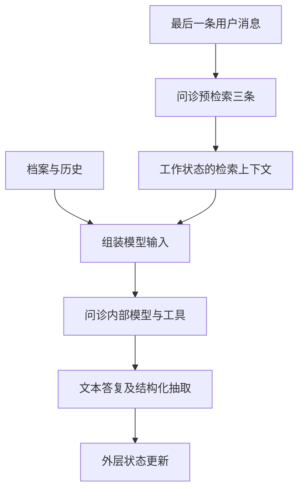

# 7.3 检索结果怎样进入回答

日期：2026-11-08。状态：已讲解／答疑中，未确认理解。第七章到此统一答疑。

## 核心结论

- RAG 是检索到生成的整条链，工具返回片段后还需要实际进入模型输入。
- 问诊走显式 Top-3 预检索，同时内部 Agent 挂载检索工具；推荐没有同样的预检索，靠提示词要求内部 Agent 调工具，并可读取已有 rag_context。
- Top-3 只限制该次预检索候选数，不是整个节点的总检索次数或最终总上下文长度上限。
- 检索、翻译、输入选择与生成每一层都可能出错；没有代码证明引用资料后就不会产生幻觉。
- rag_context 是字符串，不附带可靠的成功状态、来源类型或轮次标识；其非空不等于有效证据。

## 关键文件与函数

- [ask_symptom.py](../../petdoctor/agents/ask_symptom.py)：inject_rag_context、_build_agent_input、_collect_rag_context、ask_symptom_node。
- [recommend_product.py](../../petdoctor/agents/recommend_product.py)：_build_agent_input、_collect_rag_context、recommend_product_node。
- [rag.py](../../petdoctor/tools/rag.py)：pet_knowledge_search。
- [state.py](../../petdoctor/state.py)：rag_context 为可选字符串。
- [main.py](../../main.py)：_print_answer 决定最后展示的消息。

问诊预检索源码：

```python
context = pet_knowledge_search.invoke({"query": query, "top_k": 3})
```

组装输入节选：

```python
if state.get("rag_context"):
    context.append(f"已有知识库检索上下文（供参考）：\n{state['rag_context']}")
if context:
    messages = [SystemMessage(content="\n\n".join(context)), *messages]
```

这一步把资料实际转为输入消息；外层 State 的字段不会自行传入模型。

## 数据路径



省略错误处理、安全审查和最终显示；内部 Agent 可另行调用检索/病历工具。

## 与其他模块的关系

| 模块 | 信息性质 |
|---|---|
| RAG 知识库 | 可供不同用户参考的领域资料 |
| Memory | 当前用户/宠物档案、历史与会话状态 |
| MCP 病历工具 | 外部业务系统返回的个体记录，本项目服务为演示数据 |
| 提示词与输入组装 | 指定任务并决定如何呈现上述信息 |
| 输出抽取/安全/入口 | 整理状态、进行后续检查、选择显示消息 |

## 重要限制

- 预检索使用最后一条用户消息，没有自动将宠物档案与完整历史合成检索问题。“那怎么办”这种追问可能缺少可检索语义；内部 Agent 可以另查，但不保证每次补救成功。
- 预检索工具返回“知识库暂不可用”等非空提示，也会被写入 rag_context；这不是有效资料。
- 预检索抛异常时 inject_rag_context 返回空更新；working_state 可能沿用旧 rag_context。不能认为新轮次必有新证据。
- 问诊优先把预检索内容写回 rag_context，即使内部还有其他工具结果；未预检索时 _collect_rag_context 收集所有 ToolMessage，没有按工具名过滤，可能混入病历内容。
- 推荐注入已有 rag_context，完成后从内部 ToolMessage 收集新内容回写；无法仅凭字段存在证明其与当前问题相关。
- 工具片段带文件名，但输出抽取与最终显示不保证保留引用。无自动逐结论证据校验或物种硬过滤。
- 字符串资料被组合为 SystemMessage；外部资料不是可信指令，信任边界的具体问题留到安全章节。

## 诊断问题的观察顺序

1. 资料是否存在、内容与适用范围是否可靠。
2. 预处理是否保留关键上下文，新增资料是否实际入库。
3. 本次 query 是否表达了完整需求，候选是否相关。
4. 翻译与输入组装是否改变、遗漏或混入信息。
5. 模型结论是否有依据，后续抽取与显示是否保留应有内容。

这些是教学分析方法，本次不运行评估或开展修复。

## 验证与答疑

仅静态核对源码，未下载、重建、检索或调用收费模型；没有当前命中率/准确率结论。重要答疑：暂无。
